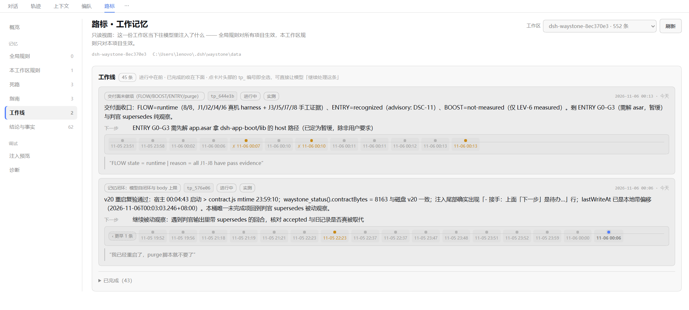
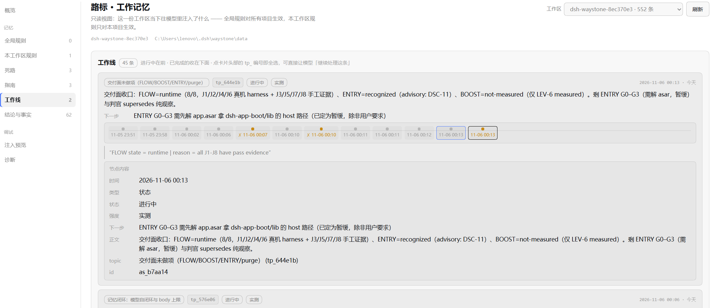

# dsh-waystone（路标）


DSH 的**工作记忆插件**。上下文一压缩、一换窗口，前面聊过的东西就没了；这个插件负责把「丢了就再也找不回来」的那部分留在盘上，并在下一轮重新摆到模型眼前。

它解决四类具体的丢失：

- **做到哪了**：每个正在做的事是一条「线」，带当前状态和下一步，换窗口后模型接着做，不用你复述。
- **你说过的硬约束**：出现「以后都 / 禁止 / 必须」这类要求时记成规约，每轮注入，防止改着改着又犯。
- **试过的死路**：错的方向记下来，防止下次又走一遍。
- **环境事实**：构建/测试/运行命令、平台限制这些「一换窗口就要重新摸索」的东西，汇总成 `[项目档案]` 常驻注入。

## 安装

包本体是一个标准 npm 包（16 个文件，无运行时依赖），已发布到 npm registry：

```bash
npm i dsh-waystone
```

装进 DSH：把包名交给插槽管理即可（`pnpm add dsh-waystone` 实测会把 `dsh-waystone` 自动登记进 profile 的 `bundles`）：

```
plugin_manager(install_bundle, target=dsh-waystone)
```

不走 registry 的来源（离线 / 钉版本 / 改代码）：

```bash
# GitHub Release 的 tarball
npm i https://github.com/lujfsd/dsh-waystone/releases/download/v0.1.2/dsh-waystone-0.1.2.tgz

# 已下载到本地的同一个 tarball
npm i /path/to/dsh-waystone-0.1.1.tgz

# 从源码
git clone https://github.com/lujfsd/dsh-waystone.git
```

后两种来源装进 DSH 时，`target` 换成包目录或 `.tgz` 的绝对路径。

然后**重启 DSH**：服务端模块与客户端 bundle 都在宿主启动时加载，不重启不会生效。重启后会话顶部出现「路标」标签页，说明装配成功。

## 模型每轮看到什么

| 段落 | 内容 | 什么时候出现 |
|---|---|---|
| `[waystone · 工作记忆契约]` | 插件使用说明（怎么记、怎么查、什么该记），固定文本 | 总是 |
| `[规约 · 全局]` / `[规约 · 本工作区]` | 你的硬要求，按强度排序，超预算截断 | 有规则时 |
| `[指南索引]` | 与本轮话题相关的可复用步骤，只给标题+id | 命中时 |
| `[项目档案]` | 构建/测试/运行/平台限制的摘要 | 工作区里事实够多时 |
| `[交接]` | 每个进行中的一条线：`名称 (tp_xxxxxx)：做到哪；下一步：…` | 有未完成的线时 |
| `[死路 · 别重试]` | 踩过的坑，按轮次轮转展示 3 条 | 有时 |

交接段的取舍：**前 3 条线给全（正文 + 下一步），第 4 条起只给「名称 + topic_id + 下一步」（最多再 6 条）**，再多就只报总数 —— 被挤掉的线不会静默消失，至少能看到它还开着。

## 三个工具

| 工具 | 干什么 |
|---|---|
| `waystone_write` | 写记录。模型自查、你手动补记都走它 |
| `waystone_recall` | 按键词 / 记录 id（`as_xxxxxx`）/ topic id（`tp_xxxxxx`）取回原文；默认不返回已被取代的旧记录，加 `include_expired:true` 取全 |
| `waystone_status` | doctor：数据根、条数、陈旧锚点、判官是否降级；`injected:true` 回显**本轮真实注入原文**，可逐字节核对 |

记录分 6 类：`state`（做到哪，按线一条）、`rule`（你的硬要求）、`conclusion`（带依据的判断）、`guide`（下次能照着跑的步骤）、`fact`（环境事实，只留指针）、`deadend`（死路）。

## 配置项

改法只有一处：**设置页「插件 → waystone → 配置」**（写进当前 profile 的 `cordis.patch.yml` 里 `waystone` 那一行），或直接编辑该行。**改动下一轮生效**。没有插件的私有配置文件——只有一个来源，就不会出现「改了没生效」。

| 键 | 默认 | 范围 | 管什么 |
|---|---|---|---|
| `rulesMax` | 30 | 1–200 | **只**管「规约」（你的硬要求）条数；全局库与各工作区库各自计数，结论/事实/指南/死路都不计入。超了淘汰「最久没被召回 + 强度最低」那条，新写的照样能进 |
| `injectBudgetTokens` | 1500 | 200–8000 | 每轮注入的总预算（词元，按 2 字符 ≈ 1 词元估算）。规约段用全额，交接段只用 55%（最少 300） |
| `compactPoolMax` | 60 | 20–500 | 「结论与事实」里还「有效」的记录总数（结论 + 事实，被否决的结论也算结论；自动生成的 `[项目档案]` 不算）达到多少条，触发一次自动合并整理 |
| `compactBatch` | 60 | 10–200 | 单次整理最多把最新多少条送进模型；调小省输入但收敛慢 |
| `dataDir` | 空 | 路径 | 存储根。**填什么就是什么，不会在你填的目录下再补 `waystone/data` 层**；根下只有 `global/`（全局规则）与 `ws/`（各工作区）。只有留空才用默认根 `<宿主数据目录>/waystone/data`。环境变量 `WAYSTONE_DATA_DIR` 优先级更高 |

非法值不会静默吞掉：会在注入面上带字段名提示（如 `[记忆不可用：E_CONFIG config.rulesMax]`），完整原因在 `waystone_status` 与 `errors.log`。

**换存储根不会自动搬数据**：改 `dataDir` 后新根是空库，旧数据原样留在原处。运行期**刻意不做**自动迁移 —— 静默搬盘比空库更危险，所以只在两个地方提供显式迁移：

1. **查看页一键迁移**（推荐）：打开「路标 → 诊断 → 旧数据根」，会列出旧根路径和条数；点「迁移到当前根」→ 再点一次「确认迁移 N 条？」才真正复制。**只有当前根是空库时按钮才出现**（已有数据就拒绝，不合并），且只复制、不删源。服务端只接受 `POST /api/waystone/migrate`、只认它自己列出的旧根，传别的路径一律拒绝。
2. **命令行**（要合并或删源时用）：

```
node scripts/migrate-data-root.mjs --to <新根> --dry-run   # 先看计划
node scripts/migrate-data-root.mjs --to <新根>             # 复制 + 逐行校验，源保留
node scripts/migrate-data-root.mjs --to <新根> --prune     # 校验通过后删源
node scripts/migrate-data-root.mjs --to <新根> --merge     # 新根已有数据时按 id 并集
```

迁移后旧目录仍在原处：确认新根数据齐全，再自己删旧目录（脚本 `--prune` 或手动）。

## 「路标」查看页

会话顶部标签页：只读（唯一例外是「诊断 → 旧数据根」里的显式迁移，要连点两次确认才发请求）。左侧导航分区：概览 / 全局规则 / 本工作区规则 / 死路 / 指南 / 工作线 / 结论与事实 / 注入预览 / 诊断。

- **概览**：条数指标 + 「当前状态」（就是模型这一轮看到的交接段原文）+ 注入记录。
- **工作线**：每条线一张卡，头部带 `tp_xxxxxx` —— **点一下即全选，复制后可以直接跟模型说「继续处理 tp_xxxxxx」**。卡里有该线的正文/下一步，以及同 topic 的时间线（左旧右新，点节点看那一条的内容）和挂在它下面的结论/事实/指南/死路。
- **注入预览**：本轮注入逐字节原文，怀疑模型没看到什么时先看这里。



点时间线上的任一节点，会在卡片下方展开那条记录的全貌（时间 / 类型 / 状态 / 强度 / 下一步 / 正文 / topic / id）：



## 数据与隐私

- 数据只在自己数据根内，追加写（append-only），**没有修改和删除**；状态（进行中/已完成/已取代/已过期）是读的时候算出来的。
- 卸载默认**保留**数据；想清干净就删 `<dataDir>` 与 `~/.dsh/waystone/errors.log`（没有隐式清理命令）。
- 不上传会话、不做第三方代理、不读宿主的私有文件，也不改你已有的提示内容 —— 只在它自己的位置追加段落。
- 只有带 `source.quote` 的判断/规约才会被接受，且 `rule` 的引文必须是本会话你原话的子串 —— 防止模型把自己的推测写成「用户要求」。

## 许可

[MIT](LICENSE) © 2026 dsh-waystone contributors
